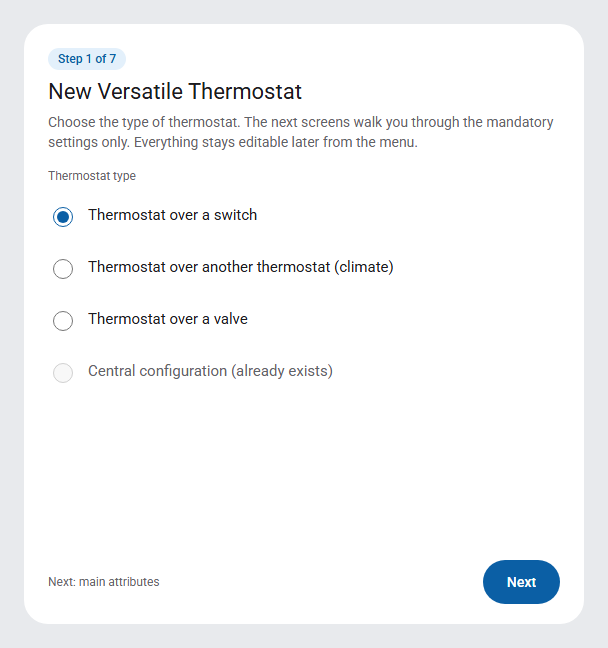
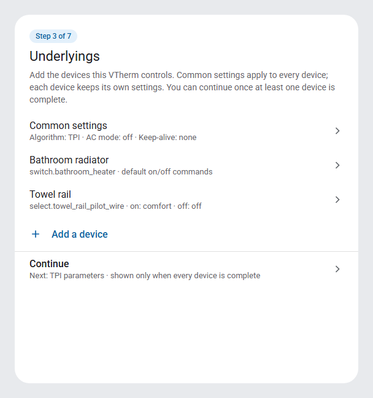
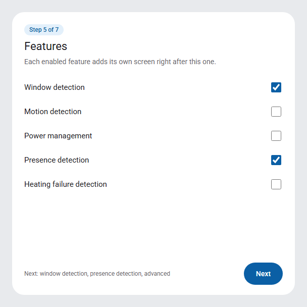
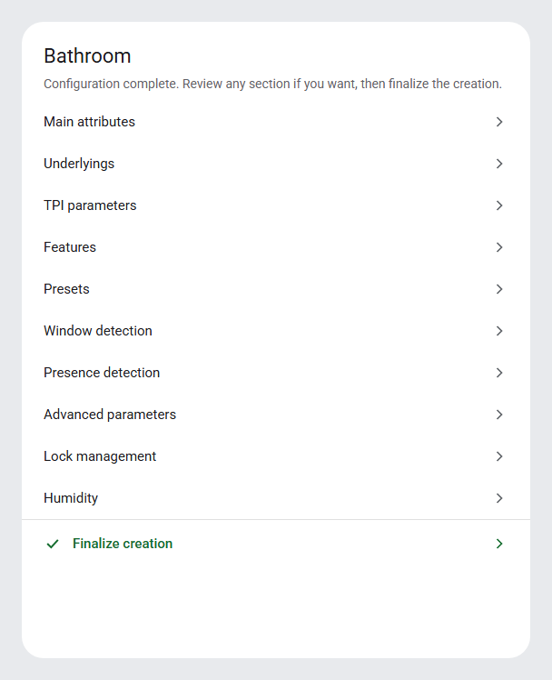
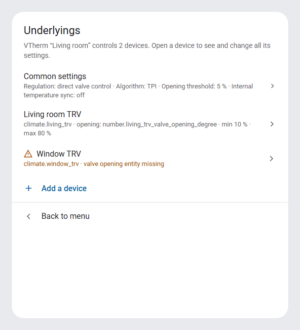
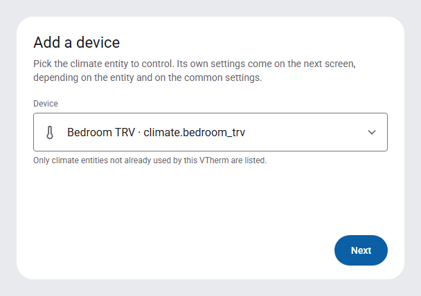
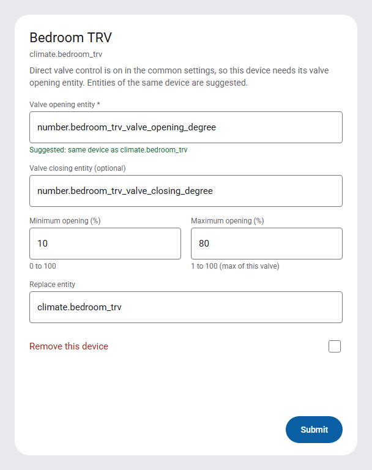
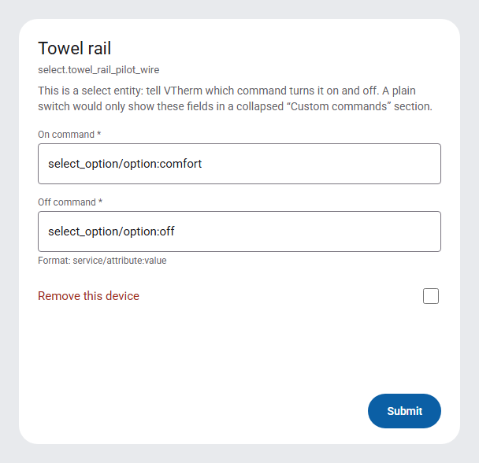
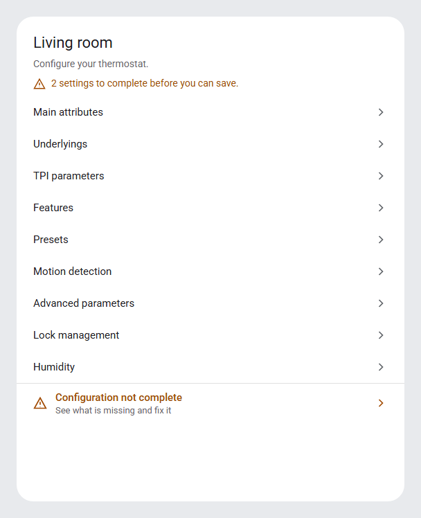
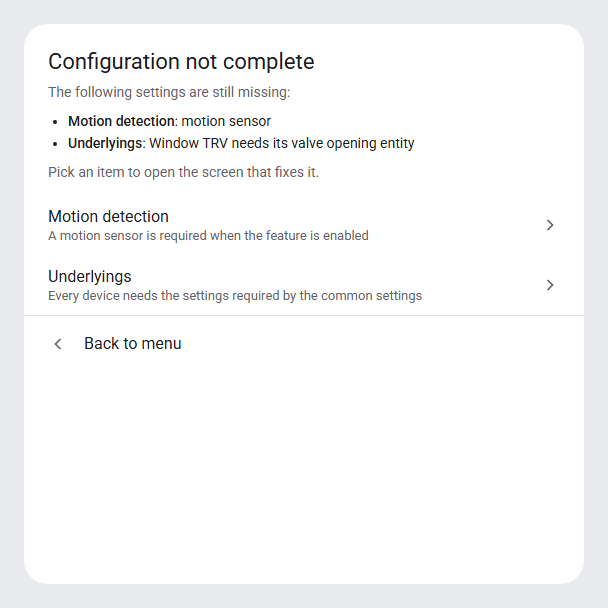

# Simplifying VTherm configuration — plan

Status: draft, no code change. Sources examined: [config_flow.py](../../custom_components/versatile_thermostat/config_flow.py), [config_schema.py](../../custom_components/versatile_thermostat/config_schema.py), [translations/en.json](../../custom_components/versatile_thermostat/translations/en.json), the HA frontend (`step-flow-menu.ts`, `show-dialog-config-flow.ts`) and `homeassistant/data_entry_flow.py`.

Mockups: [screens below](#9-mockups) and the [clickable version](https://claude.ai/artifact/54hAuWNThMb7EVerPCGj8C).

## 1. Current situation

### 1.1 Current creation path

`async_step_user` (type selection) goes straight to `async_step_menu`. The user lands on a menu with 8 to 15 entries and has to guess what to fill in, and in which order. As long as `check_config_complete()` returns `False`, the menu shows "Configuration not complete" instead of "Finalize creation".

### 1.2 "Configuration not complete" says nothing

`async_step_configuration_not_complete` just redisplays the menu. `check_config_complete()` returns a plain boolean although it evaluates about fifteen rules (temperature sensor, underlyings, TPI coefficients, motion sensor, presence sensor, safety parameters, valve list consistency, etc.). The user has no way to know which one is blocking.

### 1.3 Underlyings: parallel lists matched by position

The "Underlyings" screen (`step_id="type"`) takes a list of entities (`underlying_entity_ids`). The settings specific to each device are entered elsewhere, as lists that must be in the same order:

| Type | Per-device setting | Current form | Screen |
| --- | --- | --- | --- |
| over_switch | on / off command | `vswitch_on_command`, `vswitch_off_command` (text lists) | type |
| over_valve | min / max opening | `min_opening_degrees`, `max_opening_degrees` (CSV string "20, 25, 30") | type |
| over_climate + valve regulation | opening / closing entity | `opening_degree_entity_ids`, `closing_degree_entity_ids` | valve_regulation |
| over_climate + valve regulation | min / max opening | `min_opening_degrees`, `max_opening_degrees` (CSV) | valve_regulation |
| over_climate + internal temperature sync | calibration / external temperature entity | `sync_entity_ids` | sync_device_internal_temp |

Consequences: errors such as `valve_regulation_nb_entities_incorrect`, `sync_device_internal_temp_nb_entities_incorrect`, `valve_control_parameters_cardinality_incorrect`, `vswitch_configuration_incorrect`; no way to see at a glance which valve belongs to which TRV; `valve_regulation` and `sync_device_internal_temp` screens that appear in the menu with no visible link to the underlyings.

## 2. Home Assistant config flow constraints

Minimum version declared in `hacs.json`: HA 2026.3.1. Everything below is available from that version.

| Topic | Possible | Not possible / limit |
| --- | --- | --- |
| Forms | Selectors (Entity, Number, Select, Text, Template…), suggested values, errors per field or `base` | No reactive conditional field: a field cannot appear depending on the value of another field of the same form. Every condition means a following screen. |
| Sections | `data_entry_flow.section(schema, {"collapsed": True})`: collapsible groups | Values come back nested (`user_input["section"]`) and must be flattened before `merge_user_input` |
| Dynamic selectors | The schema is built at each display: `NumberSelector(max=…)` can use the valve's real `max`, `EntitySelector(include_entities=[…])` can restrict to entities of the same device | — |
| Menus | `async_show_menu(menu_options=[…])`; translated label `menu_options.<id>` **with** `description_placeholders`; per-option description `menu_option_descriptions.<id>` with placeholders too (checked in `show-dialog-config-flow.ts`) | If `menu_options` is a dict, labels are shown raw (not translated). No error can be shown on a menu. |
| Steps | Several methods can share the same translation `step_id` (already done: `spec_main` displays `main`) | Each menu option must map to an `async_step_<id>` method (the `FlowManager` checks `hasattr`). Dynamic options require generated methods and one translation key per option, hence a maximum number of slots. |
| Navigation | Free chaining from step to step | No native "Back" button; going back is only possible through a menu option. No native progress indicator (a "Step 3/7" can be written through a placeholder). |
| Description | Markdown + placeholders in a form or menu description | Text computed in Python is not translated by the frontend; it must be translated server-side (`async_get_translations`, server language rather than user profile language) or only static translation keys must be used. |
| Persistence | During creation nothing is written before `async_create_entry` | Closing the dialog during the wizard loses the input (acceptable). |
| Config subentries | List of items that can be added from the integration page | Rejected for underlyings: different data model, edited outside the options menu, heavy migration, reload per subentry. |

## 3. Change 1 — Creation wizard

### 3.1 Principle

Only in `VersatileThermostatConfigFlow` (creation). `VersatileThermostatOptionsFlowHandler` (editing) is unchanged: `async_step_init` opens the menu directly.

A `self._wizard_active: bool` attribute and a `_next_step()` method replace the hard-coded `next_step = self.async_step_menu`. Outside the wizard, `_next_step()` returns the menu. During the wizard, it recomputes the list of steps from `self._infos` (the list depends on earlier choices: type, central configuration, algorithm, enabled features) and returns the first step not yet visited. When the list is exhausted, the wizard ends and opens the menu.

Existing sub-steps (`spec_main`, `spec_tpi`, `auto_tpi_configuration`, `spec_window`…) keep their internal chaining; only their final "back to menu" goes through `_next_step()`.

### 3.2 Screen order

over_switch / over_valve / over_climate VTherm:

1. Type (`user`)
2. Main attributes (`main`, then `spec_main` when "use central configuration" is unchecked or there is no central configuration)
3. Underlyings (see Change 3: common settings, then the first device, then the list with "Add another" / "Continue")
4. TPI parameters (`tpi` …) when the algorithm is TPI or valve regulation is selected
5. Features (`features`)
6. One screen per enabled feature: `window`, `motion`, `power`, `presence`, `auto_start_stop`, `heating_failure_detection`
7. Advanced parameters (`advanced`, then `spec_advanced` when needed)
8. Full menu, with "Finalize creation" available

Central configuration VTherm: type → main attributes → features → enabled feature screens (including `central_boiler`) → TPI → advanced → menu.

Kept out of the wizard because they are optional and already valid with defaults: presets (`presets`), lock (`lock`), humidity (`humidity`). They stay reachable from the menu.

### 3.3 Guarantee: no incomplete configuration at the end

At the end of the wizard, `get_missing_config()` (Change 2) is called. If it is not empty (unexpected case or regression), the wizard chains to the screens to fix instead of opening the menu. A parameterized test runs the wizard for each combination (type × central configuration present/absent × valve regulation × features) and checks that the final menu contains `finalize`.

### 3.4 Working around HA limits

- No going back: the description of each wizard screen says that everything can be changed later from the menu.
- Progress: a `{wizard_progress}` placeholder ("Step 3 / 7") is added to descriptions; it is an empty string outside the wizard and in the options flow.

## 4. Change 2 — Explicit missing configuration

### 4.1 Refactoring `check_config_complete`

`check_config_complete(infos) -> bool` becomes `get_missing_config(infos) -> list[MissingItem]`, where `MissingItem` carries the `step_id` to open and the fields involved. `check_config_complete` becomes `not get_missing_config(infos)`. Mapping of the current rules:

| Current rule | Step to open |
| --- | --- |
| name, temperature sensor, cycle duration missing | main |
| outdoor sensor missing without central configuration | main |
| no underlying | type (underlyings) |
| number of valve / sync entities ≠ number of underlyings | type (the device involved, see Change 3) |
| motion enabled without sensor | motion |
| power enabled, not central, without `preset_power` | power |
| presence enabled, not central, without sensor | presence |
| safety parameters missing, not central | advanced |
| TPI algorithm, not central, coefficients missing | tpi |
| central presets without central configuration | presets |
| central config: outdoor sensor missing | main |
| central config: power sensors missing | power |
| central config: presence sensor missing | presence |
| central config: boiler services missing | central_boiler |

### 4.2 "Configuration not complete" screen

`configuration_not_complete` becomes a real menu:

- description: bulleted list of missing items, built server-side from the already translated field labels (`config.step.<step>.data.<field>`);
- options: one entry per step to fix (translated label `menu_options.<step_id>`, translated description `menu_option_descriptions.<step_id>`), plus "Back to menu".

Clicking an option opens the screen to fix directly. The main menu description also shows a summary ("2 settings to complete").

## 5. Change 3 — Reorganizing underlyings

### 5.1 List screen (menu)

The "Underlyings" menu entry (option `type`, unchanged to keep habits and translations) opens a menu:

- "Common settings": algorithm, AC mode, keep-alive, inversion (switch); regulation threshold and period, opening threshold, max closing (valve); regulation mode, auto fan, internal temperature compensation, internal temperature sync (climate);
- one entry per device: label `{underlying_n}` (entity name), description `{underlying_n_details}` ("valve: number.living_opening · min 10 % · max 80 %" or "⚠ opening entity missing");
- "Add a device";
- "Back to menu" (outside the wizard) or "Continue" (in the wizard, shown when at least one device is complete).

HA constraint: each entry needs an `async_step_underlying_<n>` method and a translation key. Proposal: 20 slots, generated methods (a `setattr` loop at class definition or a `__getattr__` limited to the `async_step_underlying_\d+` pattern), keys `"underlying_<n>": "{underlying_<n>}"` identical in every language.

### 5.2 Adding in two screens

1. `underlying_add`: pick a single entity, domains filtered by VTherm type.
2. `underlying`: settings of this device, built from the entity domain and the common settings:

| Case | Fields |
| --- | --- |
| over_switch, `switch` / `input_boolean` entity | collapsed section "Custom commands" (on / off, optional) |
| over_switch, `select` / `input_select` / `climate` entity | on and off command (required) |
| over_valve | min opening, max opening (`NumberSelector` bounded by the valve's `max` attribute) |
| over_climate + valve regulation | opening entity (required), closing entity (optional), min/max opening; entities of the same device are suggested first |
| over_climate + internal temperature sync | sync entity (required), suggested from the same device |
| over_climate without these options | no extra field: the device is added directly |

The edit screen uses the same form plus "Replace entity" and "Remove this device".

The `valve_regulation` and `sync_device_internal_temp` screens disappear from the main menu: their content is split between "Common settings" and each device.

### 5.3 Storage

Option A (recommended for the first iteration): keep the parallel lists in `config_entry.data`. A device form reads and writes index `n` of each list; removing a device removes index `n` from every list. No migration, no runtime change (`thermostat_*.py`, `underlyings.py`).

Points to settle with option A: the "all or none" rule for closing entities (`closing_degree_entity_ids` must hold 0 or N items) and for vswitch commands. Either keep the rule and explain it in the form, or accept gaps (`None`) and have the runtime handle them.

Option B (later): structured list `underlyings: [{entity_id, opening_degree_entity_id, …}]` with a migration to `CONFIG_MINOR_VERSION = 5`. Cleaner, but touches the runtime and every configuration read.

## 6. Proposed split

1. PR 1 — Change 2: `get_missing_config`, `configuration_not_complete` menu, translations. Small, independent, useful right away (including after an upgrade that adds a mandatory parameter).
2. PR 2 — Change 3: underlyings menu, add/edit/remove, merging `valve_regulation` and `sync_device_internal_temp`.
3. PR 3 — Change 1: creation wizard, reusing the underlyings screen from Change 3 and the guarantee from Change 2.

## 7. Tests

- Parameterized wizard runs (types × central config × valve regulation × sync × features): the final menu contains `finalize`.
- `get_missing_config`: one case per rule of table 4.1.
- Underlyings: add, edit, replace, remove; index consistency across all lists; default values when a CSV list is shorter.
- Options flow: always opens the menu directly; an existing configuration displays correctly in the new list.
- Translations: new keys in all 10 files (`cs`, `de`, `el`, `en`, `fr`, `it`, `pl`, `ru`, `sk`, `zh-Hans`).
- Documentation: configuration screenshots to redo.

## 8. Open questions

1. Wizard: should presets, lock and humidity be included? Proposal: no.
2. End of wizard: full menu (requested) or a "Create now / Review" screen? Proposal: full menu.
3. Closing entities and vswitch commands: keep the "all or none" rule or accept gaps?
4. Storage: option A then B, or B directly?
5. Maximum number of displayable underlyings (slots): is 20 enough?

## 9. Mockups

### Creation wizard

| Step 1 — VTherm type | Step 3 — Underlyings |
| --- | --- |
|  |  |
| **Step 5 — Features** | **End of wizard — complete menu** |
|  |  |

### Underlyings as a device list

| Underlyings list | Add a device — pick entity |
| --- | --- |
|  |  |
| **Device settings — climate with valve regulation** | **Device settings — switch over a select** |
|  |  |

### Explicit missing configuration

| Options menu — incomplete | Configuration not complete — details |
| --- | --- |
|  |  |
